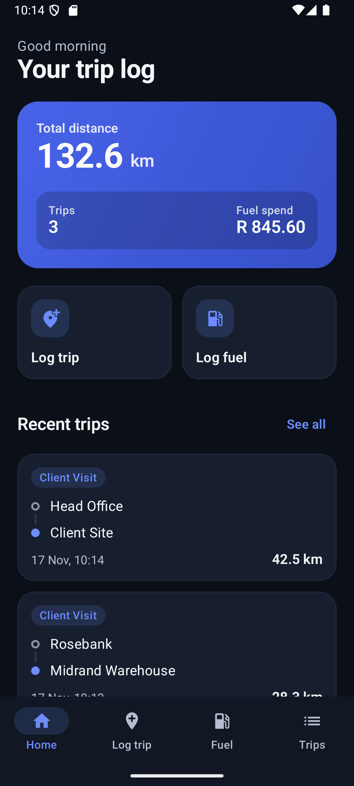
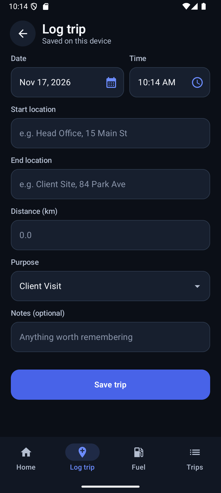
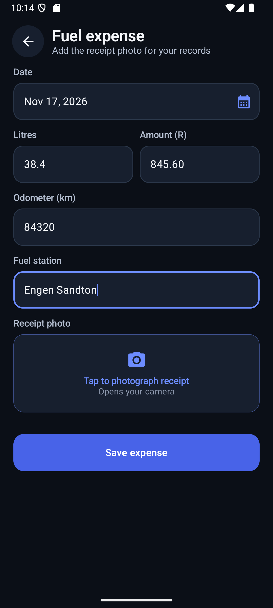
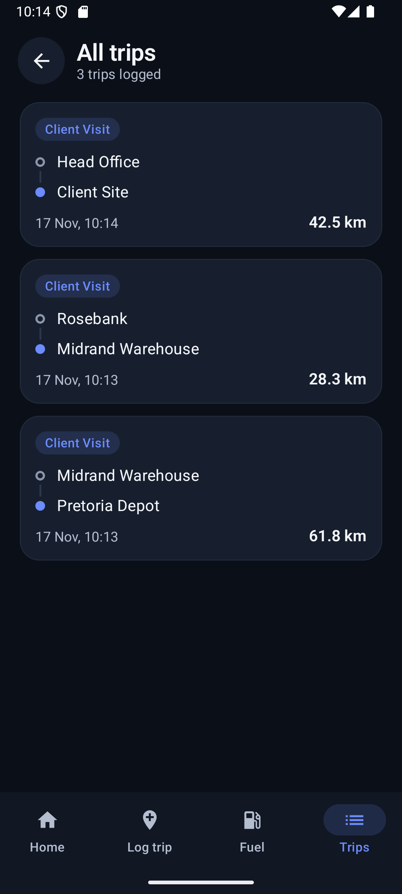
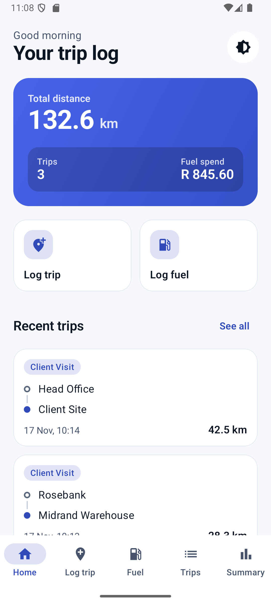
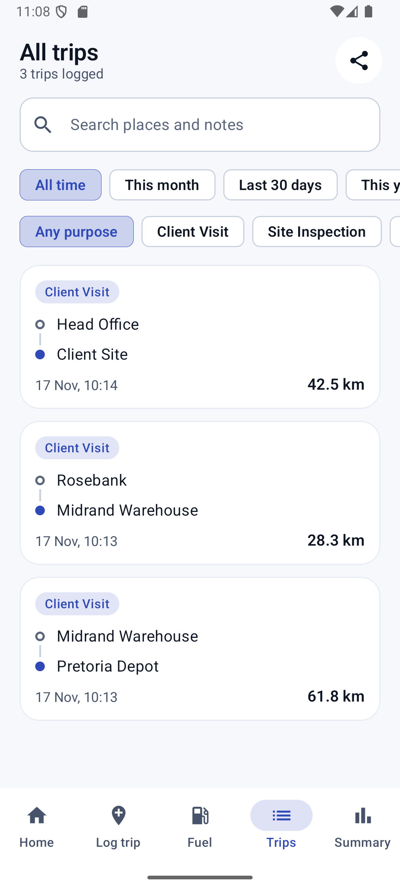

# TripLog

**A simple Android app for logging work trips and fuel expenses. Everything stays on the device.**

Built with Kotlin, Jetpack Compose, Room and Hilt. Log a trip or a fuel fill-up, attach a receipt photo, and look it up again later. There is no account, no server and no network access.

<p align="center">
  
  
  
  
</p>

<p align="center">
  
  
</p>

## Features

- **Trip logging**: start and end location, distance, purpose, date, time and notes. Tap a trip to edit or delete it.
- **Fuel expenses**: date, litres, amount (ZAR), odometer, station and a receipt photo, with a list of past expenses. Tap one to edit or delete it.
- **Monthly summary**: a Summary tab with one card per month that has activity: number of trips, distance, fuel spend, litres and fill-ups. It can be exported as CSV too.
- **Search and filters**: the Trips and Fuel screens have a search box and date range chips (all time, this month, last 30 days, this year); trips can also be filtered by purpose. The list, the totals and the CSV export all follow the filter.
- **CSV export**: the share button on the Trips and Fuel screens exports the list as a CSV file (ISO dates, dot decimals, UTF-8, safe against spreadsheet formulas) and opens the Android share sheet. The app never sends the file anywhere itself.
- **Local storage**: everything is stored in a Room (SQLite) database on the device. The app has no internet permission.
- **Receipt photos**: taken with the device camera app (no camera permission needed) and shrunk to 1600 px on the long side. Deleting or replacing a receipt removes the old photo from storage.
- **Input checks**: comma decimals are accepted; zero, negative and non-numeric values and future dates are rejected with a clear message.
- **Light and dark themes**: follows the phone setting by default, or pick Light or Dark with the button on the Home screen (the choice is remembered). Material 3 with 16sp primary body text. In both themes text and status colours meet WCAG AA contrast (4.5:1) on the app surfaces, and the white label on the primary button is about 5:1.

## Tech stack

| Layer | Technology |
|---|---|
| Language | Kotlin |
| UI | Jetpack Compose, Material 3 |
| Architecture | MVVM + Repository |
| Local DB | Room |
| DI | Hilt |
| Images | Camera capture via `TakePicture`, Coil 3 |
| Testing | JUnit 4, kotlinx-coroutines-test, hand-written fakes |
| CI | GitHub Actions: lint, unit tests, debug build |

## Project structure

```
app/src/main/java/com/triplog/
├── data/
│   ├── local/        # Room: entities, DAOs, database, converters, migrations
│   ├── settings/     # Remembered theme choice
│   └── repository/   # TripRepository, FuelExpenseRepository
├── di/               # Hilt module
├── domain/model/     # Trip, FuelExpense, TripPurpose
├── ui/
│   ├── home/  logtrip/  expenses/  trips/  summary/   # Screens + ViewModels
│   ├── navigation/   # NavGraph
│   ├── theme/        # Light and dark colours, typography, theme mode
│   └── Components.kt, Pickers.kt, Dialogs.kt, ExportShare.kt, FilterBar.kt   # Shared composables
└── util/             # Formatters, number parsing, list filters, monthly summary, CSV export, receipt image shrinking
```

## Getting started

**Requirements:** Android Studio Ladybug or newer, JDK 17 or 21 (Gradle 8.10 does not run on newer JDKs), Android device or emulator on API 26+.

```bash
git clone https://github.com/MrPettitt/triplog-android.git
cd triplog-android
./gradlew assembleDebug
```

Or open the folder in Android Studio and press **Run**. Android Studio creates `local.properties` with your SDK path automatically.

### Run the checks

```bash
./gradlew lintDebug testDebugUnitTest
```

The same commands run on every push and pull request through GitHub Actions.

## Data and backup

The trip database and receipt photos are included in Android cloud backup and device-to-device transfer (see `res/xml/data_extraction_rules.xml`). Nothing else is. The database schema is exported to `app/schemas/` and upgrades from every earlier version are covered by migrations in `data/local/Migrations.kt`, so existing trips and expenses are kept.

## License

[MIT](LICENSE)
