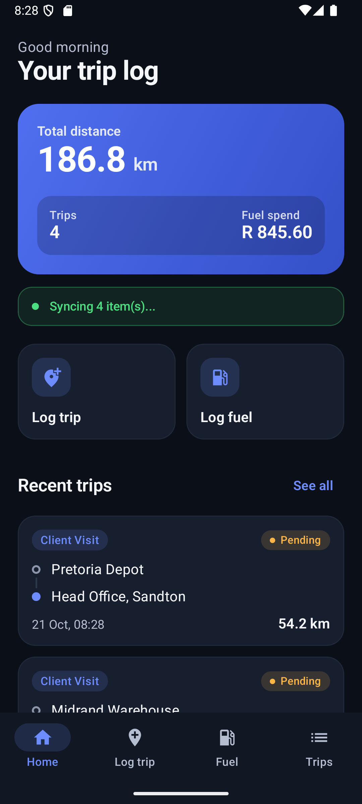
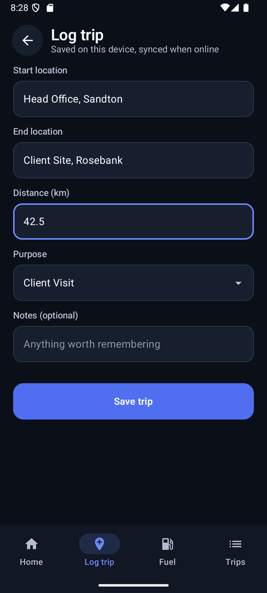
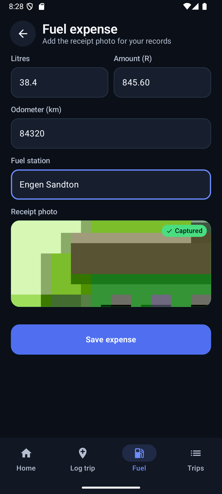
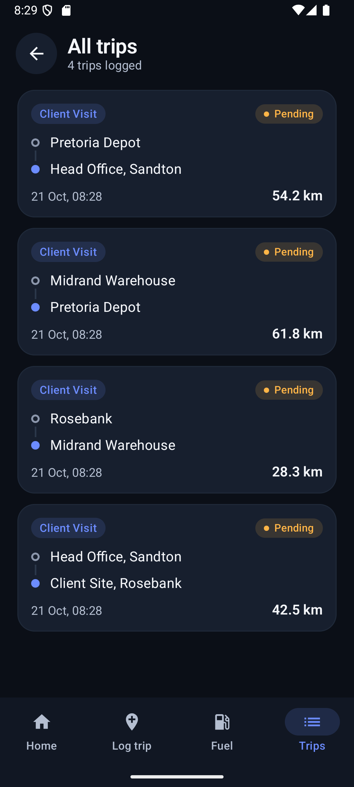

# TripLog

**An offline-first Android app for logging work trips and fuel expenses, with automatic background sync.**

Built with Kotlin, Jetpack Compose, Room, Hilt and WorkManager. Log a trip or a fuel fill-up with no signal, and TripLog uploads it the moment the device is back online.

<p align="center">
  
  
  
  
</p>

## Features

- **Trip logging**: start and end location, distance, purpose, date and notes.
- **Fuel expenses**: litres, amount (ZAR), odometer, station and a receipt photo.
- **Offline first**: everything is stored in Room (SQLite) first, so nothing is lost without a connection.
- **Automatic sync**: a `ConnectivityObserver` triggers a `SyncWorker` when the network returns, plus a 15-minute periodic sync. Records show a clear Pending or Synced status.
- **Receipt uploads**: photos are captured in-app and uploaded as multipart alongside the expense.
- **Readable dark UI**: Material 3, 16sp body text, high-contrast colours that pass WCAG AA.

## Tech stack

| Layer | Technology |
|---|---|
| Language | Kotlin |
| UI | Jetpack Compose, Material 3 |
| Architecture | MVVM + Repository |
| Local DB | Room |
| DI | Hilt |
| Background work | WorkManager |
| Networking | Retrofit, OkHttp, Moshi |
| Images | Camera capture via `TakePicture`, Coil |

## Project structure

```
app/src/main/java/com/triplog/
├── data/
│   ├── local/        # Room: entities, DAOs, database, converters
│   ├── remote/       # Retrofit ApiService and DTOs
│   └── repository/   # TripRepository, FuelExpenseRepository
├── di/               # Hilt modules
├── domain/model/     # Trip, FuelExpense, TripPurpose
├── ui/
│   ├── home/  logtrip/  expenses/  trips/   # Screens + ViewModels
│   ├── navigation/   # NavGraph
│   ├── theme/        # Colours, typography, theme
│   └── Components.kt # Shared composables
├── util/             # ConnectivityObserver, formatters
└── worker/           # SyncWorker
```

## Getting started

**Requirements:** Android Studio Ladybug or newer, JDK 17 or 21, Android device or emulator on API 26+.

```bash
git clone https://github.com/MrPettitt/triplog-android.git
cd triplog-android
./gradlew assembleDebug
```

Or open the folder in Android Studio and press **Run**. Android Studio creates `local.properties` with your SDK path automatically.

### Configure the backend (optional)

The app works fully offline. To enable sync, set your API URL in `app/build.gradle.kts`:

```kotlin
buildConfigField("String", "API_BASE_URL", "\"https://your-api-url.com/api/v1/\"")
```

To add authentication, attach your token in the OkHttp interceptor in `di/AppModule.kt`.

## Backend API contract

```
POST  /api/v1/trips
GET   /api/v1/trips
POST  /api/v1/fuel-expenses
POST  /api/v1/fuel-expenses/{id}/receipt   (multipart)
GET   /api/v1/fuel-expenses
```

Request and response shapes are in `data/remote/dto/Dtos.kt`.

## Roadmap

- [ ] Employee authentication (JWT / OAuth)
- [ ] Employer web dashboard
- [ ] Automatic distance via Google Maps
- [ ] PDF / CSV expense report export
- [ ] Sync status notifications

## License

[MIT](LICENSE)
